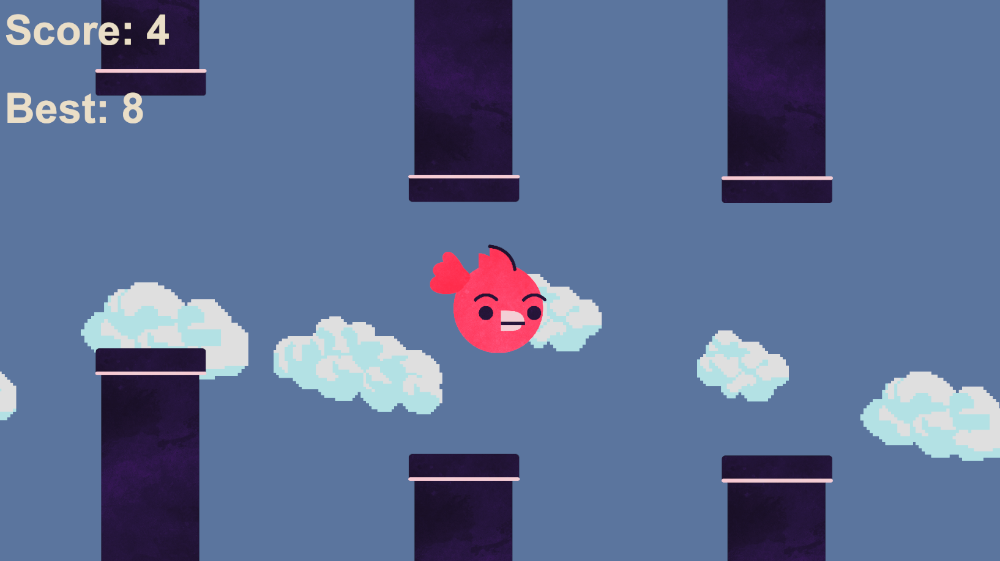

# Flappy Bird - Unity 2D

A Flappy Bird-style game created in Unity 6 as part of Lab 5 for COMP 2008 - Game Development at St. Lawrence College.

The objective is to keep the bird flying through gaps between randomly generated pipes without colliding with them. Each successful pass increases the player's score.

The game also tracks the player's highest score, saving their personal best between game sessions.

## Screenshot



## Gameplay

- Click **PLAY** on the title screen to start the game.
- Press **Space** to make the bird flap upward.
- Avoid colliding with the pipes.
- Keep the bird within the screen boundaries.
- Earn points by successfully passing through pipes.
- Try to beat your previous high score!
- Click **Restart** after Game Over to try again.

## Features

### Bird Movement and Physics

- Bird movement using Unity's Rigidbody2D physics
- Pressing Space applies upward velocity to the bird
- Gravity continuously pulls the bird downward
- Bird movement is restricted by upper and lower screen boundaries
- Colliding with a pipe or leaving the screen ends the game

### Pipes and Scoring

- Randomly generated pipes with varying heights
- Pipes continuously move across the screen
- Pipes are destroyed after leaving the playable area
- Trigger-based scoring when the bird successfully passes through a pipe
- On-screen score display updates whenever the player earns a point
- Sound effect plays when the player scores

### Persistent High Scores

- Tracks the player's highest score across game sessions
- Uses Unity's `PlayerPrefs` system to save and retrieve the high score
- Loads the previously saved high score when the gameplay scene starts
- Defaults to a high score of zero if no previous record exists
- Compares the player's final score against their previous record when the game ends
- Saves a new record only when the player beats their previous high score
- Updates the on-screen **Best** score when a new record is achieved
- High scores remain saved after restarting the game or closing Unity

### Game Over and Restart

- Game Over screen appears when the bird collides with an obstacle or leaves the screen
- Game pauses using `Time.timeScale = 0f`
- Game Over sound effect plays when the player dies
- Prevents Game Over logic from executing multiple times
- Restart button reloads the gameplay scene
- Game time resets when restarting so physics and movement work correctly

### Bird Animation

- Animated bird wings using Unity's Animation system
- Separate wing sprites for the up and down positions
- Wing sprites change position using animation keyframes
- Wing animation plays when the player presses Space
- Wings return to their resting position after each flap
- Animation restarts with each Space press
- Flapping sound effect plays when the bird jumps

### Background and Visual Effects

- Animated background clouds using Unity's Particle System
- Six different pixel-art cloud sprites
- Randomized cloud sizes and spawning heights
- Clouds continuously move across the background
- Cloud particles render behind gameplay objects
- Matching background colours between the title screen and gameplay scene

### Title Screen

- Separate title screen with a PLAY button
- Uses Unity's SceneManager to load the main gameplay scene
- Game time is reset before loading the gameplay scene
- UI created using Unity's Legacy UI components

## How the High Score System Works

The game uses Unity's `PlayerPrefs` system to store the player's personal best.

When the gameplay scene starts, the saved high score is retrieved using:

```csharp
highScore = PlayerPrefs.GetInt("HighScore", 0);
```

The `"HighScore"` string is the key used to identify the saved value.

If the player has never achieved a high score, the default value of `0` is returned.

When the game ends, the player's final score is compared against their previous record.

If the player has beaten their high score, the new record is saved:

```csharp
if (playerScore > highScore)
{
    highScore = playerScore;
    highScoreText.text = "Best: " + highScore.ToString();

    PlayerPrefs.SetInt("HighScore", highScore);
    PlayerPrefs.Save();
}
```

This approach saves the player's score when the game ends rather than checking for a new record every time the player earns a point.

The saved value persists between game sessions, allowing players to continue trying to beat their previous record.

## About This Project

This project was created to practise the fundamentals of 2D game development in Unity, including physics, collision detection, spawning objects, UI elements, animations, particle effects, scene management and persistent data storage.

The bird's movement is controlled through C#, while Unity's Animator handles the wing-flapping animation. The animation is triggered by the same Space key input that makes the bird jump, allowing the wings to flap in response to the player's actions rather than continuously.

The game uses separate scenes for the title screen and gameplay. Unity's SceneManager handles switching between scenes and restarting the game.

The high-score system was added as an additional enhancement to practise saving and retrieving data using Unity's PlayerPrefs system.

Further gameplay enhancements are planned.

## Built With

- Unity 6 (6000.2.6f2)
- C#
- Visual Studio
- Git and GitHub