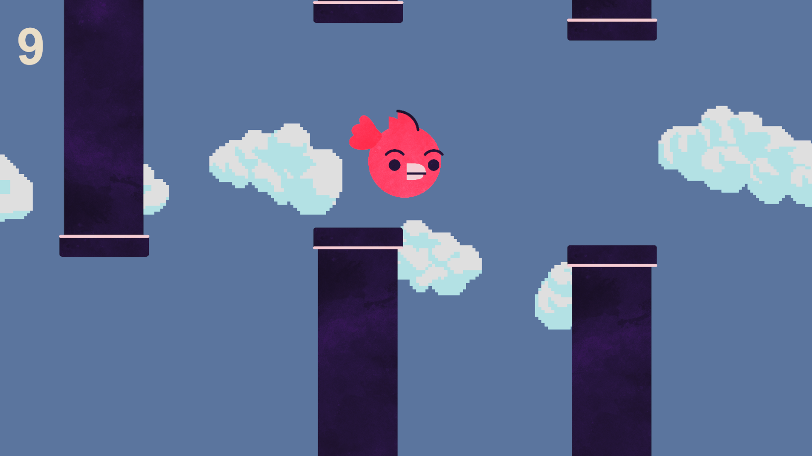

# Flappy Bird - Unity 2D

A simple Flappy Bird-style game created in Unity 6 as part of Lab 5 for COMP 2008 - Game Development at St. Lawrence College.

The objective is to keep the bird flying through gaps between randomly generated pipes without colliding with them. Each successful pass increases the player's score.

## Screenshot

## Gameplay

- Click **PLAY** on the title screen to start the game.
- Press **Space** to make the bird flap upward.
- Avoid colliding with the pipes.
- Keep the bird within the screen boundaries.
- Earn points by successfully passing through pipes.
- Try to survive as long as possible!
- Click **Restart** after Game Over to try again.

## Features

- Bird movement using Unity's Rigidbody2D physics
- Randomly generated pipes with varying heights
- Collision detection and score tracking
- Game Over screen with a restart button
- Game pauses when the player dies
- Game ends if the bird flies above or below the screen
- Sound effects for flapping, scoring and Game Over
- Animated background clouds using Unity's Particle System
  - Six different pixel-art cloud sprites
  - Randomized cloud sizes and spawning heights
  - Clouds continuously move across the background
- Animated bird wings using Unity's Animation system
  - Separate wing sprites for the up and down positions
  - Wing sprites change position using animation keyframes
  - Animation plays when the player presses Space
  - Wings return to their resting position after each flap
  - Animation restarts with each Space press
- Separate title screen with a PLAY button
  - Uses Unity's SceneManager to load the main gameplay scene
  - Matching background colours between scenes
- Game Over handling prevents repeated death events
  - Ensures the Game Over sound plays correctly
  - Prevents Game Over logic from repeatedly executing
  - Allows the game to restart correctly after collisions or leaving the screen

## About This Project

This project was created to practice the fundamentals of 2D game development in Unity, including physics, collision detection, spawning objects, UI elements, animations, particle effects and scene management.

The bird's movement is controlled through C#, while Unity's Animator handles the wing-flapping animation. The animation is triggered by the same Space key input that makes the bird jump, allowing the wings to flap in response to the player's actions rather than continuously.

The game uses separate scenes for the title screen and gameplay. Unity's SceneManager handles switching between scenes and restarting the game.

Additional enhancements are planned, including **persistent high scores** and an **additional gameplay mechanic**.

## Built With

- Unity 6 (6000.2.6f2)
- C#
- Visual Studio