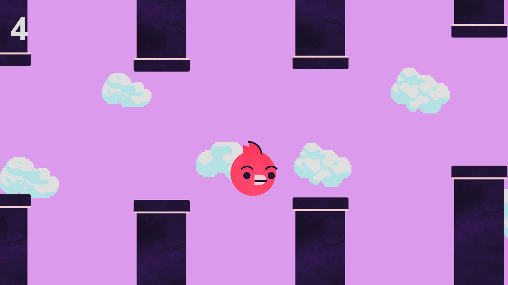

# Flappy Bird - Unity 2D

A simple Flappy Bird-style game created in Unity 6 as part of Lab 5 for COMP 2008 - Game Development at St. Lawrence College.

The objective is to keep the bird flying through gaps between randomly generated pipes without colliding with them. Each successful pass increases the player's score.

## Screenshot

## Gameplay

- Press **Space** to make the bird flap upward.
- Avoid colliding with the pipes.
- Keep the bird within the screen boundaries.
- Earn points by successfully passing through pipes.
- Try to survive as long as possible!

## Features

- Bird movement using Unity's Rigidbody2D physics
- Randomly generated pipes with varying heights
- Collision detection and score tracking
- Game Over screen with a restart button
- Game pauses when the player dies
- Game ends if the bird flies above or below the screen
- Sound effects for flapping, scoring and Game Over
- Animated background clouds using Unity's Particle System
  - Six different pixel-art cloud sprites
  - Randomized cloud sizes and spawning heights
  - Clouds continuously move across the background

## About This Project

Additional enhancements are planned, including **bird animations**, a **title screen**, **persistent high scores** and an **additional gameplay mechanic**.

## Built With

- Unity 6 (6000.2.6f2)
- C#
- Visual Studio

